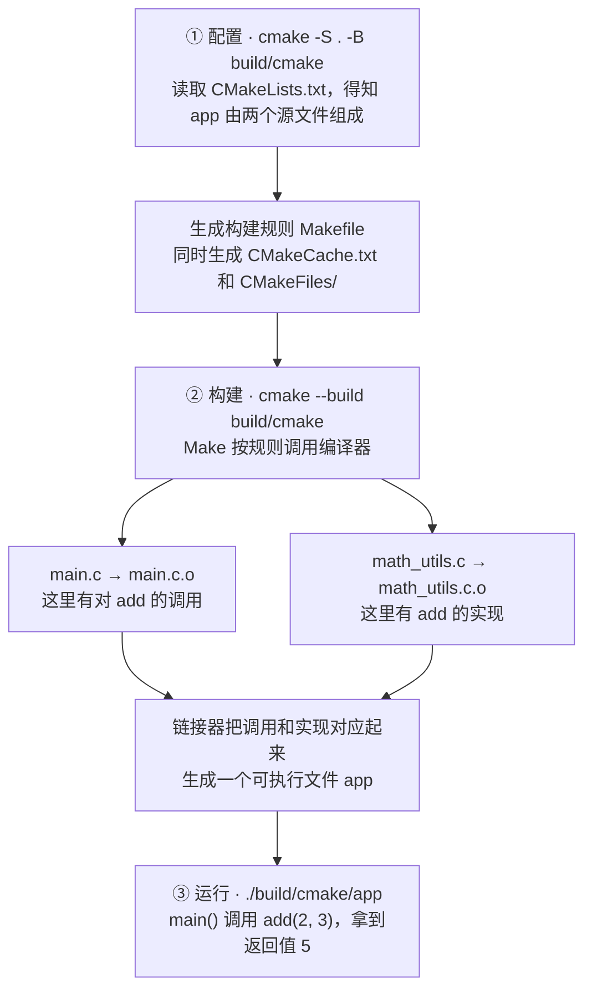

# CMake 构建与直接运行示例

构建把 C 源码变成可执行文件，运行则启动已经生成的程序。这个示例用同一个加法程序演示手动构建、CMake 构建和直接运行。

本例在 Linux 终端操作，需要 C 编译器（`cc`）、CMake 3.16 或更新版本，以及 Make。先进入示例目录。

```bash
cd "/home/zhangwei/文档/study-notes/work/example/cmake-build-vs-run"
```

- `main.c` 提供程序入口 `main()` 并调用 `add(2, 3)`。
- `math_utils.h` 声明 `add()`，`math_utils.c` 提供实现。
- `CMakeLists.txt` 用 `add_executable(app main.c math_utils.c)` 指定目标 `app` 及其两个源文件。

## 1. 手动编译和链接，再运行

```bash
mkdir -p build
cc main.c math_utils.c -o build/app-direct
./build/app-direct
```

第二条命令把两个源文件编译并链接成 `build/app-direct`。最后一条命令启动它，输出 `5`。对于这样的两文件程序，一条 `cc` 命令就可以完成构建。

如果 IDE 里的按钮只构建当前文件，打开 `main.c` 点击运行时，可能相当于只执行下面这条构建命令。

```bash
cc main.c -o build/app-main-only
```

这条命令预期在链接阶段报错，例如 `undefined reference to 'add'`。头文件让编译器知道如何调用 `add()`，链接器还需要由 `math_utils.c` 编译出的实现。

## 2. 通过 CMake 构建，再运行

```bash
cmake -S . -B build/cmake -G "Unix Makefiles"
cmake --build build/cmake
./build/cmake/app
```



1. 第一条命令读取 `CMakeLists.txt`，在 `build/cmake/` 生成 `Makefile`、`CMakeCache.txt` 和 `CMakeFiles/`。`Makefile` 保存给 Make 使用的构建规则，`CMakeCache.txt` 保存配置，`CMakeFiles/` 存放内部构建信息和中间文件。
2. 第二条命令调用 Make，根据规则编译两个源文件并链接出 `build/cmake/app`。
3. 第三条命令启动这个可执行文件，也输出 `5`。

IDE 若选中了项目的 `app` 目标，可以把构建和启动串成一次点击。编译命令里的源文件列表由项目配置提供。相关规则见 [CMake 命令行手册](https://cmake.org/cmake/help/latest/manual/cmake.1.html)。

## 3. 修改源码后直接运行

把 `main.c` 里的 `add(2, 3)` 改成 `add(2, 8)` 并保存，然后执行：

```bash
./build/cmake/app
cmake --build build/cmake
./build/cmake/app
```

第一次运行仍输出 `5`，因为执行的是上一次构建得到的程序。重新构建后，第二次运行输出 `10`。如果要恢复示例，把 `8` 改回 `3` 后重新构建。

`CMakeLists.txt`、生成的 `Makefile` 和 `CMakeFiles/` 都参与配置或构建。`./build/cmake/app` 启动的是生成的二进制文件，运行时从 `main()` 进入程序代码。构建文件的详细作用见 [[Makefile常用语法与Kbuild笔记]]。
